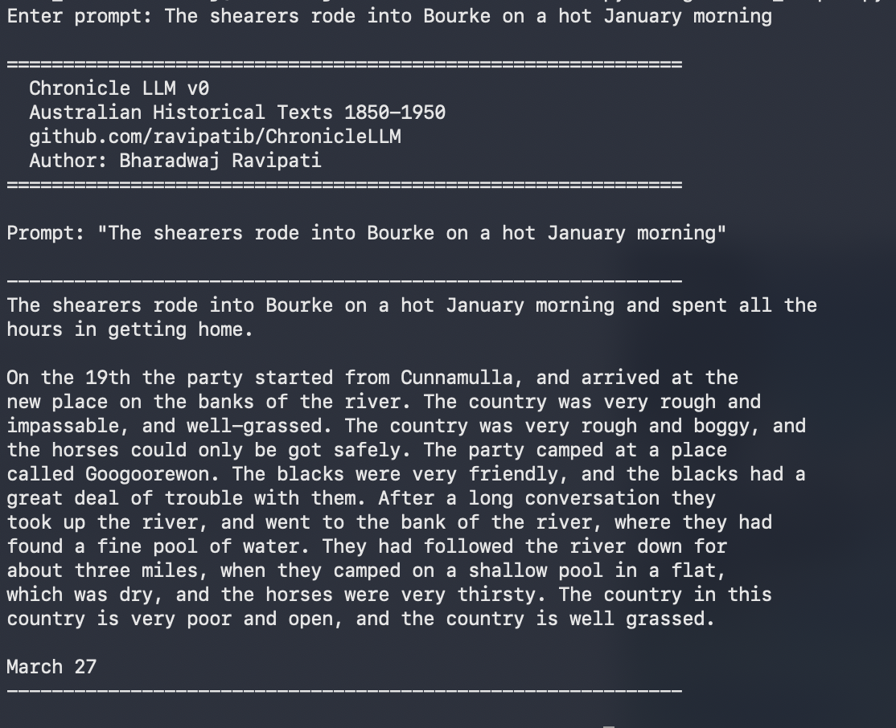
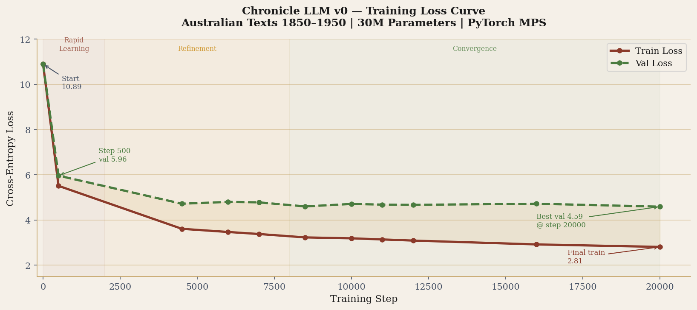
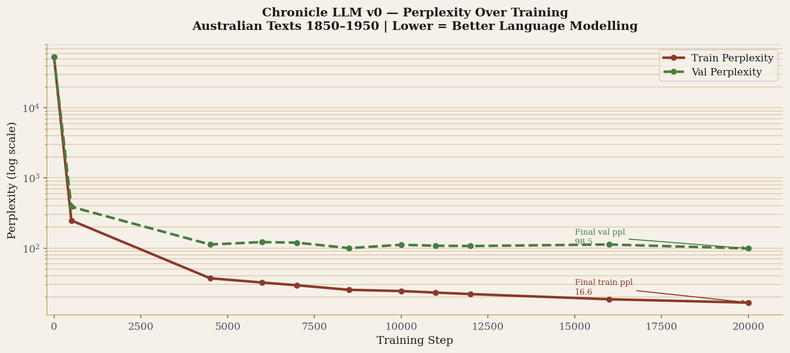
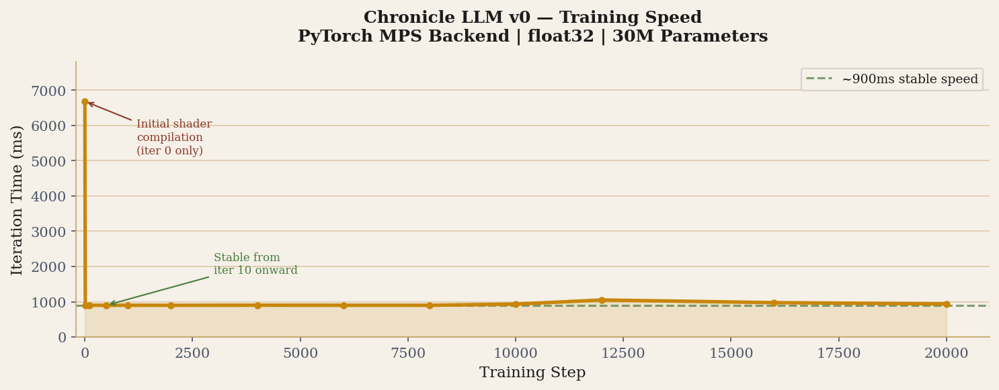
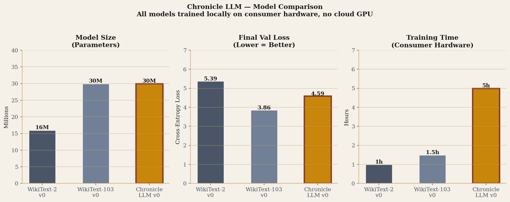

# Chronicle LLM 🇦🇺

A GPT-style language model trained from scratch on Australian texts from 1850–1950.
No fine-tuning. No modern weights. Built entirely from historical Australian writing.

[](https://opensource.org/licenses/MIT)
[](https://python.org)
[](https://pytorch.org)
[](https://github.com/karpathy/nanoGPT)
[]()
[]()
[](https://huggingface.co/Gnayo/chronicle-llm-v0)

---

## Why I built this

I got curious about whether training a model from scratch on a narrow
historical window would actually make it think differently, not just
sound different. The obvious way to test that was to try it.

Australia 1850-1950 felt like the right window. A hundred years of
gold rushes, bush life, convicts, federation, two world wars. Dense
with character and far enough back that nothing leaks through from
the modern world.

There's also a personal reason. I wanted to understand what daily life
in that era actually felt like, not the headline events but the texture
of it. How people spoke, what they read, what mattered on an ordinary
day in 1890. Building something that absorbed that language from the
inside seemed like a more interesting way to explore it.

v0 is small and the outputs are rough in places. But it works in the
sense that matters: the model has no idea what a smartphone is, and
it does know what a billy of tea is.

---

## The training approach

Most historical AI projects fine-tune an existing model. The problem
with that is the original training doesn't go away. You end up with
a model that sounds historical but still knows about modern things
underneath.

Training from scratch on exclusively historical data means the model
only knows what it was shown. No modern English underneath. No
contamination from post-1950 text.

I'm calling this Selective Temporal Training (STT): pick a time and
place window, train only on data from within it, start from zero.

---

## What the model knows

The training data covers:

- Gold rush era - Ballarat, Eureka Stockade, diggers, licence hunts
- Bush life - droving, shearing, selection, swagmen, the outback
- Convict era - transportation, penal colonies, emancipists
- Federation period - Australian identity, 1901 Constitution
- WWI - Gallipoli, Anzac, the Western Front, mateship
- Colonial cities - Melbourne, Sydney, class tension, immigration
- Exploration - Leichhardt, Sturt, Eyre, Burke and Wills
- Literature - Lawson, Paterson, Clarke, Baynton, Franklin

v1 adds a much wider shelf: colonial histories, settlers' memoirs, travel
accounts, cookery and household books, sermons, law reports, verse and novels
printed in Melbourne and Sydney, and the Commonwealth Parliament's own debates
from Federation through two world wars, in the words of Barton, Deakin, Hughes,
Lyons, Curtin and Menzies.

What it doesn't know: anything after 1950 (v1 stops at 1945). No television,
no Cold War, no modern Australia. It simply hasn't seen any of that.

---

## Sample output

**Prompt:** *The shearers rode into Bourke on a hot January morning*

```
The shearers rode into Bourke on a hot January morning and spent all the
hours in getting home.

On the 19th the party started from Cunnamulla, and arrived at the
new place on the banks of the river. The country was very rough and
impassable, and well-grassed. The party camped at a place
called Googoorewon. The blacks were very friendly, and the blacks had a
great deal of trouble with them. After a long conversation they
took up the river, and went to the bank of the river, where they had
found a fine pool of water. They had followed the river down for
about three miles, when they camped on a shallow pool in a flat,
which was dry, and the horses were very thirsty. The country in this
country is very poor and open, and the country is well grassed.

March 27
```

Bourke, Cunnamulla, and Googoorewon are all real places. The model
picked these up from exploration journals in the training data, not
from any external knowledge source.

### Sample Output Screenshot


---

## Training

No paid compute. v0 was trained on a single local GPU; v1 is trained on a free
Kaggle GPU notebook.

### v0

The full run took around 5 hours. Memory usage peaked at about 19GB.
PyTorch on CUDA or MPS both work fine for this model size. Anyone with a reasonably modern machine can reproduce this.

```
Parameters      : 30M
Steps           : 20,000
Final train loss: 2.81
Final val loss  : 4.59
Training data   : 55MB / 139 files / ~14M tokens (only ~70 files valid, see below)
```

The large gap between train and val loss has two causes. The model saw its
14M tokens about 23 times over, and the validation set was the alphabetically
last 10% of files, many of which turned out to be non-Australian books.

### v1 (training)

```
Parameters      : 72.8M (11 layers, 9 heads, 576 embedding)
Context length  : 512 tokens
Steps           : 10,800 x 65,536 tokens (3 epochs)
Training data   : 1,075MB / 4,157 documents / 247.8M tokens
Hardware        : free Kaggle notebook, 2x NVIDIA T4, float16
```

Why 73M and not bigger: a model wants roughly 20 training tokens per
parameter, and repeating data helps only up to about 4 epochs (Muennighoff et
al. 2023). With ~235M licence-safe training tokens, ~73M parameters over 3
epochs is about the limit before the model starts memorising books rather than
learning the language. A much larger model needs much more text, which means
Trove (see What's next).

Config: [`config/train_chronicle_v1.py`](config/train_chronicle_v1.py).
Notebook: [`kaggle/chronicle_v1_train.ipynb`](kaggle/chronicle_v1_train.ipynb).

### v0 training loss curve


### v0 perplexity over training


### v0 training speed


### v0 model comparison


---

## Training data

### v1

Every text is public domain in **both Australia and the United States**:
every author died before 1955 (Australian law), and the work is on
gutenberg.org or was first published by 1930 (US law). Australia has no
text-and-data-mining exception, so training doesn't change that test.
Anything that couldn't be shown to pass was left out.

| Source | Documents | Cleaned | Share |
|---|---|---|---|
| [Project Gutenberg](https://gutenberg.org) (proofread) | 359 | 147.0MB | 14% |
| [Project Gutenberg Australia](https://gutenberg.net.au) (proofread) | 281 | 71.4MB | 7% |
| [Internet Archive](https://archive.org) scanned books (OCR, quality-filtered) | 1,380 | 463.9MB | 43% |
| Commonwealth Hansard 1901–1945 (sample) | 2,137 | 393.2MB | 37% |
| **Total** | **4,157** | **1,075.4MB** | **247.8M tokens** |

Every book was selected from catalogue metadata and checked after download,
not typed in by hand. Authors without dates in the catalogue were looked up in
Wikidata and the Library of Congress, and counted only when every plausible
match died before 1955 (`author_deaths.csv` keeps the evidence for each one). The full licensing rule, sources, build steps and review
lists are in the [v1 dataset card](data/australia_1850_1950_v1/README.md).

Authors include Henry Lawson, Banjo Paterson, Marcus Clarke, Rolf Boldrewood,
Barbara Baynton, Steele Rudd, C.J. Dennis, Price Warung, Ada Cambridge,
Rosa Praed, Tasma, Mary Gaunt, Edward Dyson, Louis Becke, Joseph Furphy,
Henry Handel Richardson, Miles Franklin (titles first published by 1930),
E. W. Hornung, Fergus Hume, John Monash, Watkin Tench, David Collins,
K. Langloh Parker, Raffaello Carboni, James Bonwick, and exploration
journals from Leichhardt, Sturt, Eyre, Giles, and Burke & Wills among others.

### A correction about v0

An audit for v1 (`data/australia_1850_1950_v1/v0_audit.csv`) found that 66 of
v0's 139 files were the wrong book: hand-typed Gutenberg IDs pointed at
Wodehouse, Balzac, Conan Doyle, Darwin and several non-English texts. Another 9
are still in copyright in Australia (Mary Grant Bruce, Ethel Turner, Norman
Lindsay, Jeannie Gunn and others), even though they're public domain in the US.
About 70 v0 files were valid. v1 fixes this.

---

## Architecture

Built on [nanoGPT](https://github.com/karpathy/nanoGPT) by Andrej Karpathy.

GPT-2 style decoder-only transformer, GPT-2 BPE tokenizer (tiktoken),
vocab size 50,304.

| | v0 | v1 |
|---|---|---|
| Parameters | 30M | 72.8M |
| Layers | 6 | 11 |
| Attention heads | 6 | 9 |
| Embedding dim | 384 | 576 |
| Context length | 256 | 512 |
| Effective batch | 64 × 256 tokens | 128 × 512 tokens |
| Steps | 20,000 | 10,800 |
| Learning rate | 1e-3 → 1e-4 | 6e-4 → 6e-5, 300 warmup steps |
| Precision / hardware | float32, single GPU | float16, 2× T4 (Kaggle) |
| Config | [`train_chronicle_v0.py`](config/train_chronicle_v0.py) | [`train_chronicle_v1.py`](config/train_chronicle_v1.py) |

---

## Model weights

Pretrained v0 weights are on HuggingFace:
[huggingface.co/Gnayo/chronicle-llm-v0](https://huggingface.co/Gnayo/chronicle-llm-v0)

Two formats available:
- `model.safetensors` - HuggingFace format, load via transformers
- `chronicle_v0.gguf` - GGUF format, load directly in LM Studio or llama.cpp

v1 weights will be published once training is done, exported with
[`scripts/v1/export_hf.py`](scripts/v1/export_hf.py) (Hugging Face
safetensors, checked to give the same logits as the nanoGPT checkpoint).

---

## Running it

```bash
git clone https://github.com/ravipatib/ChronicleLLM
cd ChronicleLLM
pip install -r requirements.txt
```

This project requires nanoGPT as a dependency:

```bash
git clone https://github.com/karpathy/nanoGPT
```

Build the v1 dataset (downloads take roughly 2–3 hours; every step can be
re-run and skips what it already has):

```bash
curl -o pg_catalog.csv https://www.gutenberg.org/cache/epub/feeds/pg_catalog.csv
curl -o gutindex_aus.txt https://gutenberg.net.au/gutindex_aus.txt

python scripts/v1/build_gutenberg_manifest.py pg_catalog.csv
python scripts/v1/build_ia_manifest.py pg_catalog.csv
python scripts/v1/resolve_ia_authors.py
python scripts/v1/build_gutenberg_manifest.py pg_catalog.csv
python scripts/v1/build_ia_manifest.py pg_catalog.csv
python scripts/v1/fetch_gutenberg.py
python scripts/v1/fetch_pga.py gutindex_aus.txt --download
python scripts/v1/fetch_ia.py
python scripts/v1/fetch_hansard.py
python scripts/v1/clean_v1.py
python data/australia_1850_1950_v1/prepare.py
```

The committed manifests (`data/australia_1850_1950_v1/*_manifest.csv`),
`author_deaths.csv` and `pga_title_decisions.csv` record every
include/exclude decision and its reason.

Train v1 on a free Kaggle GPU: upload `train.bin`, `val.bin` and
`config/train_chronicle_v1.py` as a **private** Kaggle dataset, then run
[`kaggle/chronicle_v1_train.ipynb`](kaggle/chronicle_v1_train.ipynb) with
GPU T4 x2 (instructions are in the notebook). Or on your own GPU:

```bash
cd nanoGPT
ln -s ../data/australia_1850_1950_v1 data/australia_1850_1950_v1
# Windows users: copy the folder manually instead of using symlink
torchrun --standalone --nproc_per_node=1 train.py ../config/train_chronicle_v1.py
```

Without a CUDA GPU add `--device=mps --dtype=float32 --compile=False` (or
`--device=cpu`); this is much slower than a CUDA GPU.

Ask v1 questions (it's a base model, so questions are framed as Hansard
question time and it answers in period style, with no guarantee of facts):

```bash
python chat_v1.py --ckpt out-chronicle-v1/ckpt.pt
# You: Will the Government build a railway to Port Augusta?
# Mr DEAKIN: ...
```

The v0 pipeline (`clean_texts.py`, `data/australia_1850_1950/prepare.py`,
`config/train_chronicle_v0.py`) is kept for reference. Its file list isn't
published, and the audit above found much of it was wrong, so build v1 instead.

Generate:

Pretrained weights are available on HuggingFace:
[huggingface.co/Gnayo/chronicle-llm-v0](https://huggingface.co/Gnayo/chronicle-llm-v0)

Download `chronicle_v0.gguf` from there to use directly in LM Studio,
or load the model weights via the transformers library.

To train your own version and generate from your checkpoint:

```bash
python generate_sample.py
# Enter prompt: The goldfields of Ballarat in 1854
```

Via API (LM Studio or any OpenAI-compatible server):

```bash
curl http://localhost:1234/v1/completions \
  -H "Content-Type: application/json" \
  -d '{
    "model": "chronicle-llm/v0",
    "prompt": "The bushrangers rode hard across",
    "max_tokens": 200,
    "temperature": 0.8
  }'
```

---

## Model versions

| Version | Params | Data | Tokens | Steps | Val Loss | Status |
|---------|--------|------|--------|-------|----------|--------|
| v0 | 30M | 55MB / 139 files (~70 valid) | 14M | 20,000 | 4.59 | Done |
| v1 | 72.8M | 1,075MB / 4,157 docs | 247.8M | 10,800 | TBD | Training |
| v2 | TBD | TBD | TBD | TBD | TBD | Roadmap |

---

## What's next

- ~~v1 with more data, targeting 200MB with cleaner preprocessing~~
  Dataset done: 1,075MB / 247.8M tokens, licence-checked. Training on Kaggle.
- Trove newspaper integration (National Library of Australia). Trove's API
  terms don't allow building a training corpus, so this needs written
  permission from the NLA first.
- Work through the v1 review lists (~900 books whose author dates still
  need checking)
- An optional chat fine-tune on Hansard question-and-answer pairs (period
  dialogue, not text written by a modern AI)
- Custom tokenizer trained on Australian English
- Temporal bias analysis
- Eventually a proper conversational interface

---

## Inspiration

- [nanoGPT](https://github.com/karpathy/nanoGPT) by Andrej Karpathy - architecture
- [TimeCapsuleLLM](https://github.com/haykgrigo3/TimeCapsuleLLM) by Hayk Grigorian - STT concept
- [TinyStories](https://arxiv.org/abs/2305.07759) - small models on curated data

---

## Data sources

- [Project Gutenberg](https://gutenberg.org) and [Project Gutenberg Australia](https://gutenberg.net.au) - proofread texts
- [Internet Archive](https://archive.org) - scanned books
- Commonwealth Hansard 1901–1945, Parliament of Australia, via
  [Tim Sherratt's GLAM Workbench harvest](https://github.com/wragge/hansard-xml)
- [Trove](https://trove.nla.gov.au) - future data source, pending NLA permission

---

## Contributing

Issues and PRs welcome. Particularly interested in:
- More verified Australian 1850–1950 texts, especially author death dates for
  the `review` rows in the v1 manifests
- Better cleaning scripts
- Evaluation approaches for historical LMs

Please open an issue before submitting a PR.

---

## Citation

```bibtex
@misc{chroniclellm2025,
  author    = {Ravipati, Bharadwaj},
  title     = {Chronicle LLM: A Language Model Trained from Scratch
               on Australian Historical Texts 1850--1950},
  year      = {2026},
  publisher = {GitHub},
  url       = {https://github.com/ravipatib/ChronicleLLM}
}
```

---

## License

Code: MIT. See [LICENSE](LICENSE) for details.

Training texts are public domain in Australia and the United States (see the
[v1 dataset card](data/australia_1850_1950_v1/README.md)). Hansard text is
courtesy of the Parliament of Australia.

Copyright (c) 2026 Bharadwaj Ravipati

---
